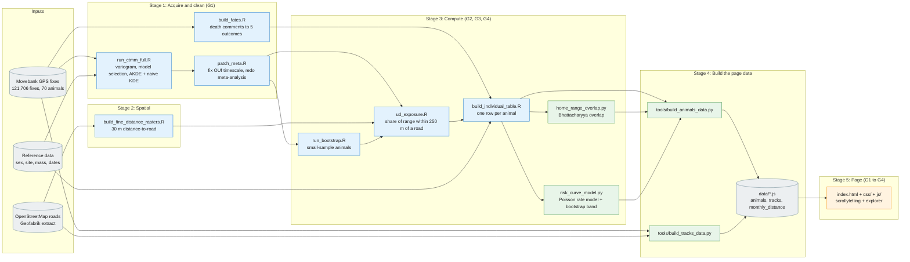
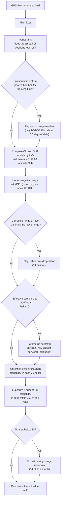
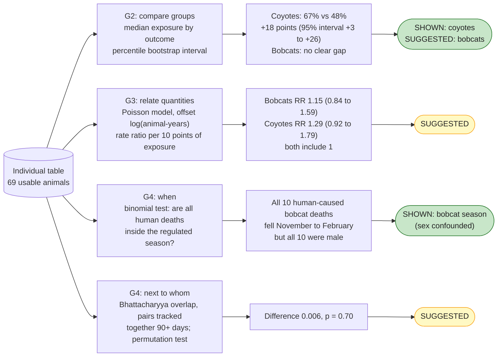
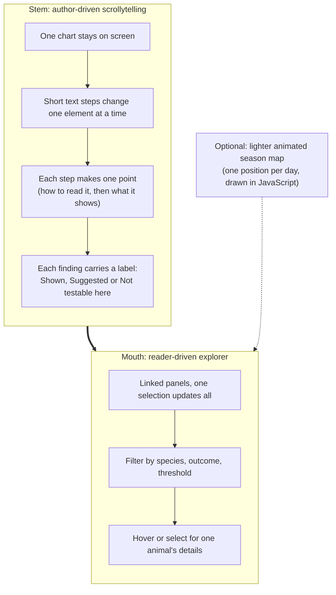

# Workflow diagrams

Five diagrams show how the project fits together, from raw GPS data to the page a reader sees.
Each diagram is a picture; the editable Mermaid source is folded under it. Stage names match **Table 2** of the report, and goals **G1 to G4** are the four project goals.

| Goal | Question | Output |
|---|---|---|
| G1 | Can the home-range estimates be trusted, and what do they look like? | Model checks, home ranges |
| G2 | How does road exposure differ with how an animal's track ended? | Exposure by outcome |
| G3 | How does the death rate change with road exposure? | Rate model and risk curve |
| G4 | When do deaths happen, and do the two species share space? | Seasonality test, overlap test |

---

## 1. The whole pipeline

Read left to right. Each box is a script or a data file, and each arrow is a file passed on.
Blue is R, green is Python, orange is the browser, and grey is data.

Mermaid source (renders as an editable diagram on GitHub)

**How to read it:** `run_ctmm_full.R` is the slow step (one model fit per animal, cached to disk).
Everything after it is quick. The two data builders at the end are the only link between the analysis and the page,
so the page can be rebuilt without refitting any animal.

---

## 2. What happens to one animal (Stage 1 and 3 in detail)

Every animal goes through the same chain. The diamonds are the decisions that change what is reported.

Mermaid source (renders as an editable diagram on GitHub)

The three flags (not resident, extrapolated, small N_area) are different checks and catch different animals.
That is why the report says the two groups of 14 are not the same animals.

---

## 3. From exposure to claims (Stage 3 to the labels)

Each goal has one method and one evidence label. The label depends on what the interval does, not on how strong the result looks.

Mermaid source (renders as an editable diagram on GitHub)

A third label, **Not testable here**, is used for the mechanism (fear of wolves and cougars), because their locations are not public.

---

## 4. The page: a martini glass

The page follows the martini-glass structure (Segel & Heer, 2010). The author controls the narrow stem,
and the reader controls the wide mouth. Within each part, the order is overview first, then filter, then details on demand (Shneiderman, 1996).

Mermaid source (renders as an editable diagram on GitHub)

**Why it matters for the reader:** the stem keeps the load low by giving one point at a time (Sweller, 1988; Mayer, 2009),
and the mouth hands control back once the reader has the context to explore without being misled.

---

## 5. How the design changed

```mermaid
flowchart LR
  P["Proposal<br/>animated tracks over NDVI"] -->|"overplotted at 69 animals;<br/>could not show fates or uncertainty"| A["moveVis and gganimate<br/>6 attempts"]
  A -->|"reframed around questions"| B["Static figures<br/>four goals G1 to G4<br/>Shown / Suggested / Not testable"]
  B -->|"six linked charts on one screen"| C["Interactive page v1<br/>overloaded the reader"]
  C -->|"about 280 words and 16 controls<br/>above the first chart"| D["Guided page v2<br/>still too much at once"]
  D -->|"ONS scrollytelling structure"| E["Final: scrollytelling page<br/>plus linked explorer<br/>plus lighter season map"]
```

Mermaid source (renders as an editable diagram on GitHub)

Two findings changed the analysis itself: the first distance raster inherited 164 m cells (so a 250 m threshold meant about 1.4 cells),
found by tabulating its distinct values and fixed by rebuilding at 30 m; and a bug in reading the position timescale from `OUf` fits wrongly flagged three animals as non-resident,
fixed by `patch_meta.R` without refitting.
